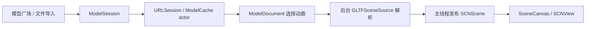

# Demo 1 · 从登录工作室到可交互的 glTF 浏览器

## 问题：如何把“能显示模型”变成完整的原生使用流程？

一个只调用 `SCNView.scene = scene` 的项目，无法说明下载任务如何取消、模型页如何退出、动画如何选取，也难以评估列表滚动和加载的开销。本 Demo 把这些问题放在同一条用户路径中：**本地演示登录 → 模型广场 → 资源详情 → 动画与手势 → 返回/退出登录**。

工作室包含精选推荐、模型搜索、离线筛选、个人页与文件导入入口。Fox 为离线动画资产，Duck 走 HTTPS 与缓存，Material study 是原创离线几何。模型广场使用系统符号绘制资源封面，避免为了封面加载额外的 3D 场景。

## 选型：SwiftUI 管页面，SceneKit 管场景

| 决策 | 原因 | 代价和边界 |
|---|---|---|
| SwiftUI + UIViewRepresentable | 页面状态、导航和表单直接用 Swift；已有 SCNView 通过 UIKit 接入 | SwiftUI 视图更新不等于创建新的渲染引擎，必须明确 Coordinator 生命周期 |
| SceneKit | 能直接观察 SCNNode、skinner、动画和摄像机，适合本题的原生节点树学习 | Apple 已标记弃用；这是指定技术栈的学习 Demo，新 Apple-only 产品应另行评估 RealityKit |
| GLTFSceneKit 固定源码版本 | glTF/GLB 到 SCNScene 的桥接直观，方便检查动画挂载逻辑 | 并非完整 glTF 生态兼容承诺；不支持的扩展、外部资源需单独验证 |
| 本地演示认证 | 让无后端环境也能验证登录状态机、表单错误、退出和导航 | 不是安全认证服务；公开固定账号不能保护数据，不能用作生产登录 |

SceneKit 的生命周期状态参考 [Apple SceneKit 文档](https://developer.apple.com/documentation/scenekit) 与 [WWDC25 迁移说明](https://developer.apple.com/videos/play/wwdc2025/288/)。保留它是为了完成节点树与既有引擎集成练习，不代表新项目默认推荐。

## 登录状态机：把演示和真实认证分开

```text
signedOut --提交完整字段--> signingIn --账号正确--> signedIn
    ↑                         │                    │
    └-------失败/取消----------┘       退出登录------┘
```

`DemoAuth` 校验公开账号 `demo@3dlab.local / Demo3D!2026`，邮箱会 trim 和转小写，密码严格匹配。350 ms 延迟只是本地交互演示，不是网络耗时。字段为空立即报错；请求期间按钮禁用，重复提交不会叠加任务；退出会取消尚未结束的任务。密码不落盘，不生成或保存 token。当前会话在 App 进程退出后消失；公共模型缓存独立于会话。

真实接入时应把校验替换为后端会话协议，服务端控制权限，凭证按实际身份服务要求存储；不要把本地 `signedIn` 布尔值当作授权边界。此项目没有注册、找回密码、OAuth 或跨设备账号同步。

## 从 URL 到场景：每一层负责什么？



下载只接受 HTTPS，成功响应后验证模型，再原子写入缓存。缓存键为 URL 的 SHA256；单个响应最多 64 MiB，磁盘预算为 256 MiB，按最近访问时间近似淘汰。它没有 ETag / Last-Modified 再验证机制：同一 URL 内容变化时需清缓存，因此还不能称作完整离线同步系统。

`ModelSession` 在新操作开始时取消旧 Task；同步第三方解析无法中途停止，但完成后会再次检查取消，防止旧结果覆盖新页面。解析放到后台，最终场景发布放在主线程。文件导入使用 security-scoped access；当前接受自包含 GLB 或 glTF，外部 `.bin`/图片引用明确报错，避免只加载半个资源后假装成功。

## 骨骼动画的陷阱：三个动作不能一起播

Fox 的 Survey / Walk / Run 共用关节。GLTFSceneKit 的加载流程会遍历所有 animation channel，并挂在对应节点上。如果把“切换”实现成只换按钮文字，动作仍可能混播。

这里先解析 GLB JSON，保留完整 buffers、accessors、skins 与 BIN chunk，仅将 `animations` 数组缩为选中的一项；重新序列化时重算 JSON padding、chunk 长度和总长度，然后交给 GLTFSceneKit。单元测试逐个验证三个片段仍包含 skinner 和节点动画。暂停通过节点暂停状态传播；切换从头播放，不包含交叉淡入淡出。

## 手势与节点树

模型归一化、旋转和平移施加在包装 pivot 上，保留源节点与骨骼引用。单指 UIPan 改 Euler 角，双指 UIPinch 改相机距离并限幅，三指 UIPan 改模型平移。未开启 `allowsCameraControl`，避免系统相机手势与自定义识别器争抢。

当前旋转使用 Euler 角，适合演示，不包含惯性、轨迹球旋转、碰撞与自动回正。`节点树` 面板显示层级和 skinner 标记，可用来对照 glTF 的 nodes/skins。

## 性能证据：截图只是入口，序列才支持结论

[性能报告](BENCHMARKS.md)记录实际执行环境、原始数据、采样方式和结论。`--capture-fps` 仅在显式启动参数启用时记录 CADisplayLink 时间戳；退出页面时写入 App Documents。UI 测试在模型广场反复上下滚动，并在 Fox 详情反复旋转。结果衡量主线程回调间隔，不等于 GPU render completion。

“帧率瞬时显示 60”不能推出“全程稳定 60”。报告会同时列出采样时长、平均回调速率、P95 帧间隔和长帧比例；若出现掉帧则如实保留。模拟器、Debug、自动化输入都有额外开销，不能代替真机 Release 指标。

## 代码导航

- [认证状态机](../App/Community/DemoAuth.swift)
- [登录 / 广场 / 个人页](../App/Community/CommunityShell.swift)
- [场景加载和交互](../App/Demos/ModelBrowser.swift)
- [缓存](../App/Core/ModelCache.swift)、[GLB 动画选取](../App/Core/ModelDocument.swift)
- [UI 回归](../UITests/DemoUITests.swift)

## 扩充离线模型库

新增 Cesium Man（1 段骨骼动画）、Avocado（静态贴图）和 Animated Box（1 段节点动画），与 Fox、Duck、Material study 共 6 项。只有 Duck 需要网络，列表数量按实际数据计算。

CesiumMan 暴露了 SceneKit 的骨骼数据兼容问题：JOINTS_0 与 TEXCOORD_0 共用 bufferView。解析器现在按 accessor offset、stride、count 提取独立骨骼缓冲区，保留原始资产和节点引用。回归同时验证 Fox 三段动画，避免新增人物时破坏旧模型。来源与许可见 [资源声明](../App/Resources/AdditionalModels-LICENSE.md)。
