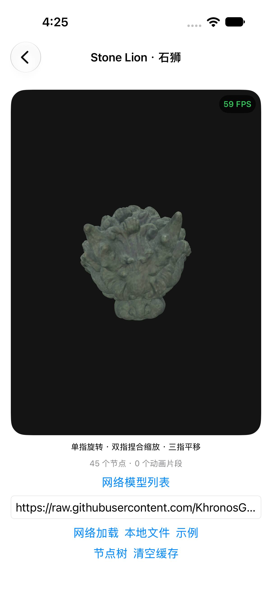
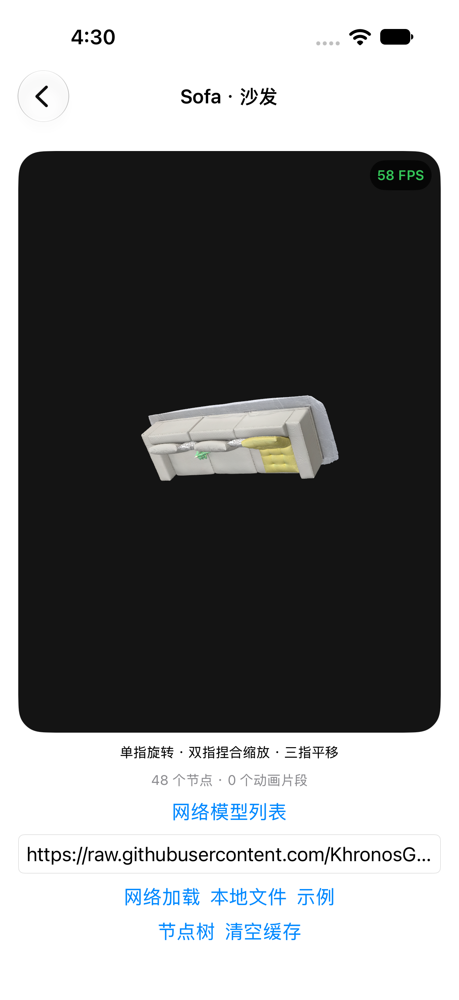
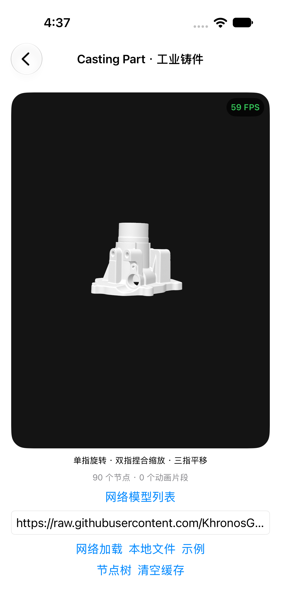
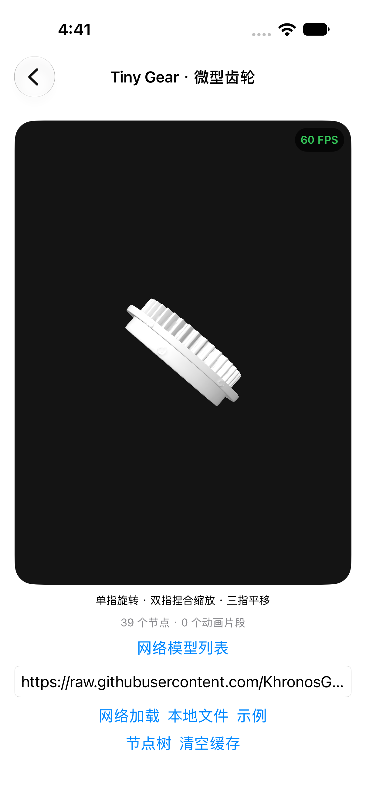
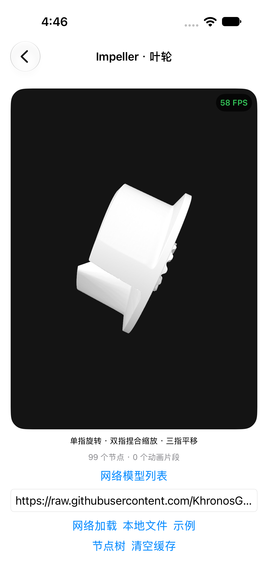
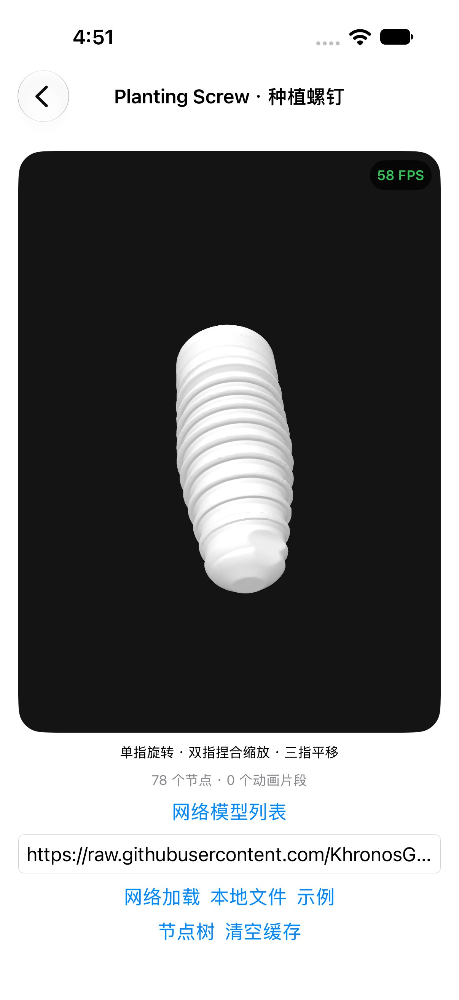
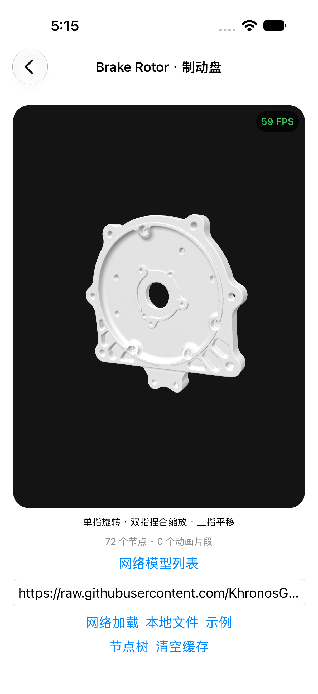

# SHINING 3D 扫描模型接入记录

核查日期：2026-10-19。石狮已收到用户从官方入口下载的 GLB，并加入离线列表；沙发也已从官方入口下载并加入离线列表。

| 模型 | 作者 | 三角形 | 顶点 | 许可 |
|---|---|---:|---:|---|
| [[With texture] Stone Lion scanned with Einstar](https://sketchfab.com/3d-models/with-texture-stone-lion-scanned-with-einstar-9708dcb6e7fc4c339804e523a23888b6) | SHINING 3D | 1,311,640 | 655,822 | [CC BY 4.0](https://creativecommons.org/licenses/by/4.0/) |
| [Sofa](https://sketchfab.com/3d-models/sofa-9d919fb16c3c4de28b9dfb1b64abec98) | SHINING 3D | 1,573,388 | 786,662 | [CC BY 4.0](https://creativecommons.org/licenses/by/4.0/) |

核查来源：Sketchfab 公开模型 API 与官方下载页面。两项 `isDownloadable` 均为 true，但实际下载入口要求登录；石狮实际文件 45,307,504 字节，包含 14 个 mesh、1 张内嵌贴图，无必需扩展；保留原始 GLB，未减面。

后续接入步骤：

1. 从授权下载入口取得原件，记录文件 SHA256、下载日期及作者署名。
2. 检查格式、外部贴图、扩展与尺寸；整理成自包含 GLB。
3. 在保留原件的基础上生成轻量版，记录减面和贴图调整，按 CC BY 4.0 标明修改。
4. 使用 GLTFSceneKit 验证几何、纹理及节点树，再添加「实物扫描」分类。
5. 实测加载耗时、内存和交互帧率；不将源站面数或理论减面比例当作性能收益。

石狮当前为高清原始版，非轻量优化版。署名与文件校验见 [许可](../App/Resources/StoneLion-LICENSE.md)。真机内存、加载耗时与帧率仍需独立测量。

截图 FPS 为单个瞬时窗口，不代表持续帧率测量。

## Sofa 下载记录

官方下载 GLB 为 55,705,888 字节（约 53.1 MiB），15 个 mesh，无必需扩展、无图片，颜色存于 COLOR_0 顶点属性。保留高清原版，未减面。[来源与许可](../App/Resources/Sofa-LICENSE.md)。

实际下载 GLB 的索引计数为 1,573,318 三角形，与源站页面的 1,573,388 略有差异；应用资产统计以实际文件为准。

当前保持源文件初始朝向，可通过单指拖动调整观察角度。

## Casting Part 下载记录

新增 SHINING 3D 的 Small Casting Part scanned with Combo+ Wireless，文件统一命名为 `CastingPart.glb`。实际大小 78,393,024 字节（74.8 MiB），29 个 mesh、2,762,059 个三角形，无必需扩展。GLB 2.0 文件头与声明长度校验通过，未做减面。

[来源、CC BY 4.0 署名和 SHA-256](../App/Resources/CastingPart-LICENSE.md)。模型广场可搜索“Casting”或“铸件”。这是高清原版，真机加载耗时、内存及持续交互帧率尚未测量。

模拟器 UI 测试加载成功：90 个节点、0 段动画，截图确认几何可见。截图瞬时 FPS 不代表持续性能。

## Tiny Gear 下载记录

官方 GLB 实际 33,167,372 字节（31.6 MiB），12 个 mesh、1,229,442 个三角形，无必需扩展。GLB 2.0 文件头和声明长度校验通过，保留原始几何，未减面。

[来源、CC BY 4.0 署名与校验值](../App/Resources/TinyGear-LICENSE.md)。真机性能尚未测量。

模拟器验证：39 个节点、无动画，几何渲染可见。截图为瞬时帧率，不代表持续性能。

## Impeller 下载记录

SHINING 3D 官方 GLB：83,965,440 字节（80.1 MiB），32 个 mesh、2,926,978 个三角形，无必需扩展。GLB 2.0 文件头和声明长度校验通过，保留原始几何，未减面。

[来源、CC BY 4.0 署名和 SHA-256](../App/Resources/Impeller-LICENSE.md)。真机性能尚未测量。

模拟器加载成功：99 个节点、0 段动画，几何可见。保持源文件初始朝向，可拖动查看叶片；截图瞬时 FPS 不代表持续性能。

## Planting Screw 下载记录

SHINING 3D 官方 GLB：71,781,620 字节（68.5 MiB），25 个 mesh、2,773,304 个三角形，无必需扩展。GLB 2.0 文件头和声明长度校验通过，保留原始几何，未减面。

[来源、CC BY 4.0 署名和 SHA-256](../App/Resources/PlantingScrew-LICENSE.md)。真机性能尚未测量。

模拟器加载成功：78 个节点、无动画，截图确认螺纹几何可见。截图瞬时 FPS 不代表持续性能。

## Brake Rotor 下载记录

SHINING 3D 官方 GLB：58,927,816 字节（56.2 MiB），23 个 mesh、1,993,775 个三角形，无必需扩展。GLB 2.0 文件头和声明长度校验通过，保留原始几何，未减面。

[来源、CC BY 4.0 署名和 SHA-256](../App/Resources/BrakeRotor-LICENSE.md)。真机性能尚未测量。

模拟器加载成功：72 个节点、无动画，截图确认盘面与孔位可见。截图瞬时 FPS 不代表持续性能。

