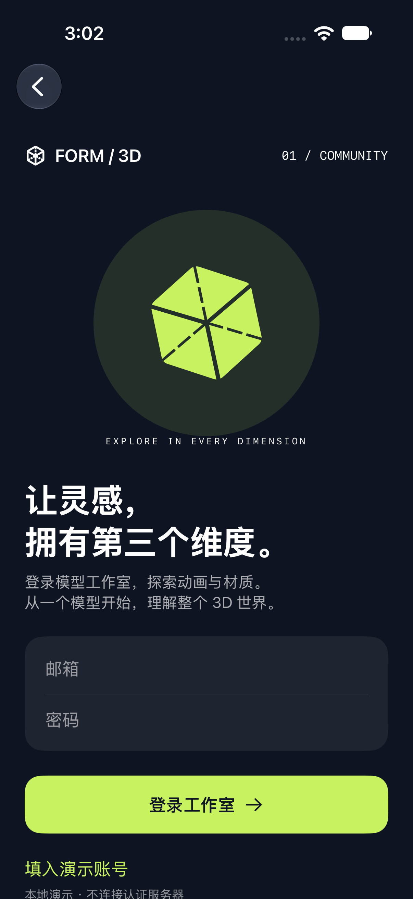
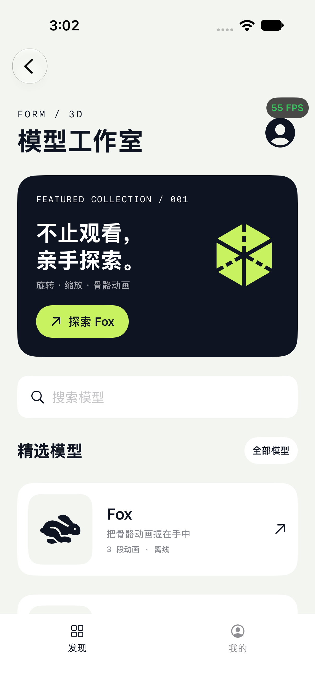
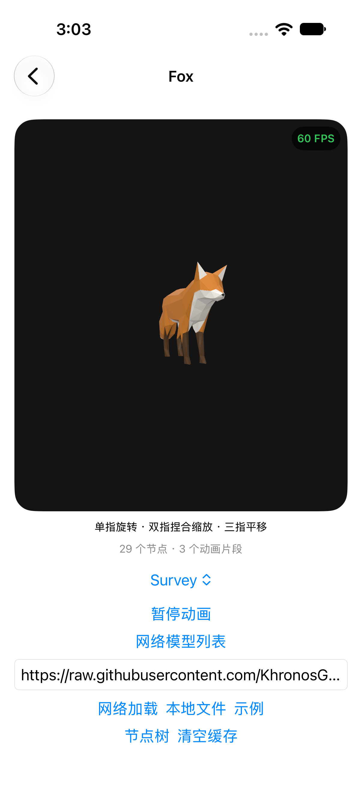
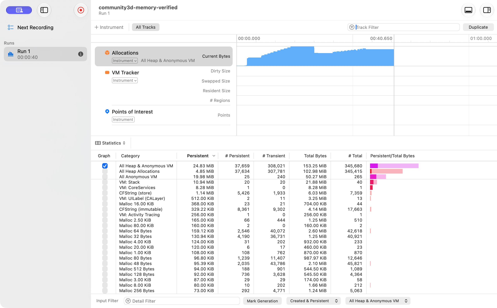
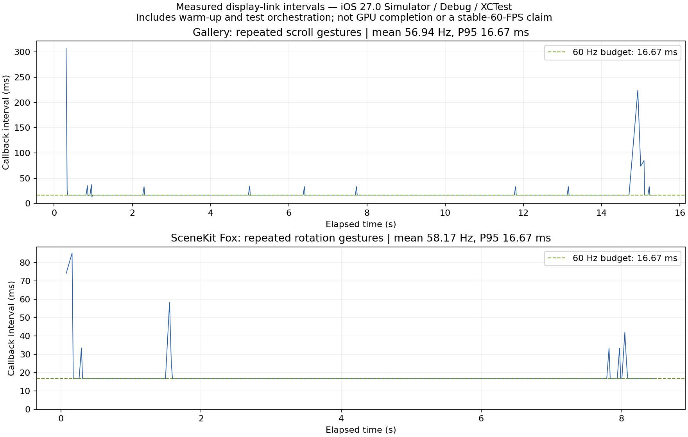
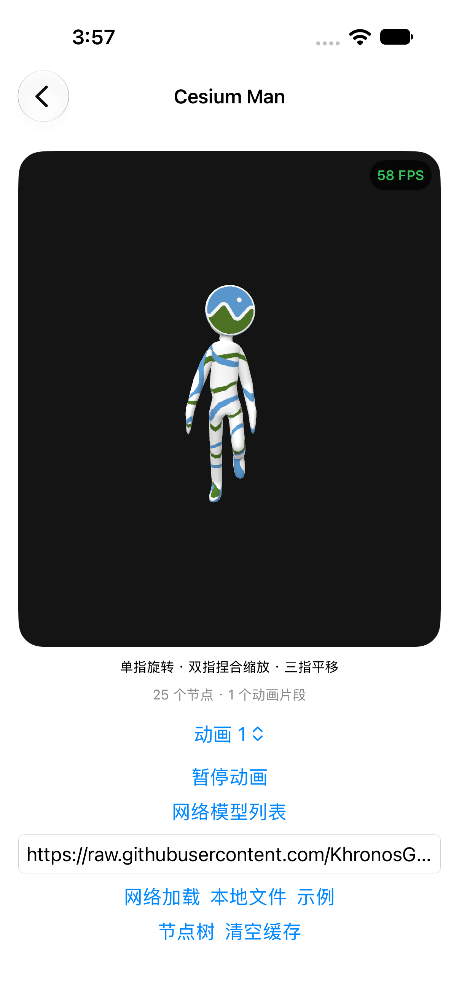
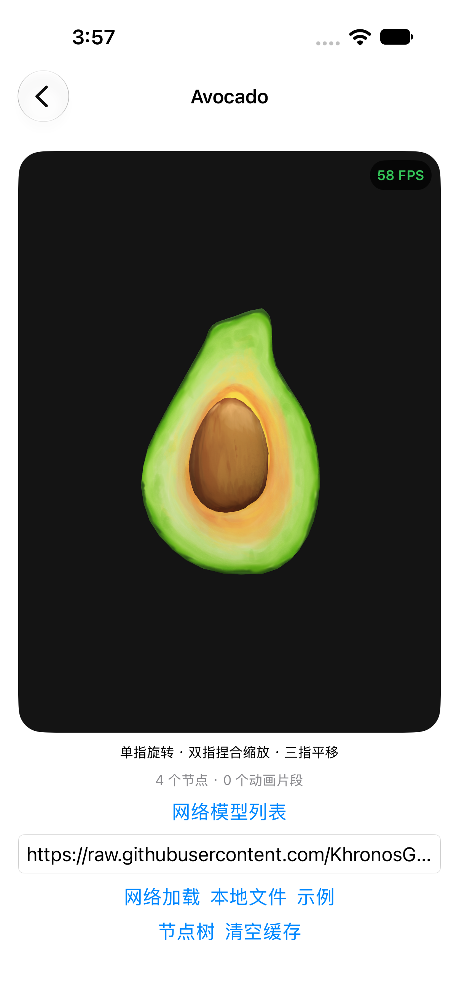

# FORM / 3D · iOS 3D Community Demos

从原生模型工作室，到跨平台 PBR，再到引用环与帧时间分析。这个仓库不仅提供三个可运行的 iOS Demo，也保留技术选型、实现取舍、踩坑、原始实验数据和结论边界。

**SwiftUI / UIKit · SceneKit / GLTFSceneKit · Objective-C++ / Filament / Metal · Instruments**

## 先看结果

  

- Demo 1 已有登录表单、错误状态、模型广场、搜索/离线筛选、个人页和退出登录；详情保留下载缓存、文件导入、手势、节点树和骨骼动画。
- Demo 2 已运行 Filament PNG/PBR 场景，ASTC 原生上传路径完成编译；当前模拟器不支持 ASTC，真机效果与内存收益待测。
- Demo 3 已用 Instruments 记录强引用环累积与解除后的真实下降曲线，原始 trace 可下载复查。
- 实测滚动平均 **56.94 FPS**，Fox 旋转平均 **58.17 FPS**（模拟器 / Debug / 自动化输入）。**没有把某张截图上的 60 写成全程稳定 60。**

## 三篇技术文章

### Demo 1：为什么 SwiftUI + SceneKit？

SwiftUI 负责登录、列表与状态，SCNView 负责原生节点树、skinner 和动画观察，UIViewRepresentable 连接两者。它适合这个指定技术栈的学习目标；Apple 已标记 SceneKit 弃用，新 Apple-only 产品应另外评估 RealityKit。[Apple 迁移说明](https://developer.apple.com/videos/play/wwdc2025/288/)

最容易忽略的问题是动画：GLTFSceneKit 会挂载全部动作通道，Fox 的三套动作却共用同一组关节。本项目先选一个完整 glTF animation，再保持 BIN、skins 和节点引用不变地重建场景，避免假切换与混播。缓存、异步取消和登录状态机也分别有明确职责。

→ [完整文章：登录状态机、加载管线、动画通道和手势](Docs/DEMO1.md)

### Demo 2：为什么 Filament，而不是沿用 SceneKit？

选择 Filament 的重点是 **iOS/Android 共用 PBR 材质与光照管线的一致性**，不是凭引擎名字宣称更快。两端可固定引擎版本、资产、IBL 和后处理；SceneKit 则无法直接成为 Android 的同一渲染核心。跨 GPU、纹理转码、曝光与显示色彩仍需对照校准，本仓库尚无 Android 验证结果。[Filament 官方介绍](https://google.github.io/filament/dup/intro.html)

ASTC 对照使用同一源图、尺寸、色彩空间和 mip 数。自定义 TextureProvider 规避默认 PNG 解码器自动生成完整 mip 链的混杂因素。1024² RGBA8 为 4 MiB、ASTC 4×4 为 1 MiB；75% 只是纹理 payload 理论节省。`MTLDevice.currentAllocatedSize`、进程 footprint、纹理 allocation 分别记录，不能相互冒充。

→ [完整文章：双端一致性、资源所有权、ASTC 实验控制](Docs/DEMO2.md)

### Demo 3：如何证明是泄漏，而不是正常缓存？

使用 `Controller → closure → Controller` 的明确引用环，对照 `[weak self]`。弱引用 Registry 观察对象，Instruments 观察分配，两个证据互补。自动实验先保留 10 个 Controller，再解除引用环，随后执行 weak 版本 10 次；原始阶段日志显示存活数 **10 → 0**，修复分支结束仍为 0。

CADisplayLink 使用 common run-loop mode 和 1 秒窗口，低于 45 FPS 限频记录。恢复后的回调栈不冒充阻塞发生时的堆栈，归因需 Time Profiler。

→ [完整文章：引用环、Instruments、FPS 口径与验收](Docs/DEMO3.md)

## 性能实测，不只放截图

### Instruments 内存曲线



上图为 iOS 27.0 模拟器 / Debug 的实际 `All Heap & Anonymous VM / Current Bytes`。引用环解除后可见下降；后续系统/图形缓存没有完全回到初始基线。结束时 Persistent 为 **24.83 MiB**，全程累计分配为 **153.25 MiB**，后者不是峰值，不能相减作为“节省量”。尚未提取释放前后的精确 MiB 差值，故不填写虚构百分比。

### 滚动和模型旋转帧时间



| 场景 | 采样时长 | 平均回调 FPS | P95 帧间隔 | 最大间隔 |
|---|---:|---:|---:|---:|
| 模型广场上下滚动 | 15.38 s | 56.94 | 16.67 ms | 307.21 ms |
| Fox 单指旋转 | 8.49 s | 58.17 | 16.67 ms | 85.07 ms |

数据包含加载和测试调度，未挑选稳定区间。它衡量 display-link 回调，不是 GPU 完成帧率；结论是多数帧接近 60 Hz，但存在长帧，不能声称全程稳定 60。

→ [完整报告、原始 timestamps、trace、复算方法与限制](Docs/BENCHMARKS.md) · [真机实验规程](Docs/EXPERIMENTS.md)

## 运行

最低 iOS 16；当前验证使用 Xcode 27.1。Filament 固定 1.78.0，GLTFSceneKit 源码固定 commit，详见 [依赖与许可](Vendor/README.md)。

```sh
brew install xcodegen
./Scripts/bootstrap.sh
open Community3D.xcodeproj
```

选择 `Community3D` scheme。首次 bootstrap 下载并校验官方 Filament SDK；离线资源已包含。真机需配置自己的签名 Team。未运行过的可选引擎源码构建入口为 `Scripts/build-filament-source.sh`，不能与当前预编译 SDK 验证混为一谈。

Demo 1 默认填入演示账号和密码，直接点击“登录工作室”即可。也可手动输入：

```text
邮箱：demo@3dlab.local
密码：Demo3D!2026
```

这是公开的本地演示账号，不连接服务器、不保存密码、不提供真实访问控制。会话仅在当前运行中保留；没有注册、OAuth 或找回密码功能。

## 实现范围

| 能力 | 当前状态 |
|---|---|
| GLB / 自包含 glTF，本地与 HTTPS | 已实现；外部 `.bin`/图片 URI 不支持 |
| 缓存 | 单文件 64 MiB、磁盘预算 256 MiB；无 ETag 再验证 |
| Fox 动画 / 三类手势 / 节点树 | 已实现；无动作交叉淡入和惯性轨迹球 |
| PBR / IBL / Metal | PNG 路径已实际运行 |
| ASTC | 固定资产 sidecar 原生适配；真机路径待验证，不是通用 glTF 扩展 |
| 内存实验 | 模拟器 Instruments trace 与对象释放证据已保存 |
| 帧率 | 连续时间戳已采集；稳定 60 与线上治理收益未证实 |

## 验证与代码导航

6 项单元测试 + 2 项 UI 测试覆盖账号校验、登录/退出、列表与模型交互、骨骼片段解析、引用环释放及三 Demo 回归。最终构建与运行记录见 [VALIDATION](Docs/VALIDATION.md)。

- `App/Community/`：认证状态与 UI 壳子
- `App/Core/`：模型数据、缓存、FPS、内存实验入口
- `App/Demos/`：三个功能页面
- `App/Filament/`：Objective-C++ 与纹理上传
- `Scripts/`：依赖准备、资产生成、性能数据绘图
- `Docs/Benchmarks/`：原始实验数据与 Instruments trace

## 资源署名

Fox：PixelMannen（模型，CC0）；tomkranis（绑定/动画，CC BY 4.0）；AsoboStudio / scurest（glTF 转换，CC BY 4.0）。[来源](https://github.com/KhronosGroup/glTF-Sample-Assets/tree/main/Models/Fox) · [完整署名](App/Resources/Fox-LICENSE.md)。模型未修改，运行时仅选择动画。Checker 和 studio HDR 为本仓库原创可复现资源。

## Demo 1 模型库

现有 6 个模型：Fox、Cesium Man（人物骨骼动画）、Avocado（牛油果贴图）、Animated Box（旋转与升降动画）、Duck（网络加载）、Material study。除 Duck 外均随 App 离线提供，支持搜索和离线筛选。新增资产约 8.2 MiB，来源、许可和 SHA256 见 [模型许可](App/Resources/AdditionalModels-LICENSE.md)。

 

新增 **Stone Lion · 石狮**（SHINING 3D 实物扫描），当前模型库共 7 项。高清原始 GLB 约 43.2 MiB，离线可用；可搜索“石狮”或“Stone”。[来源及接入记录](Docs/SCANNED_MODELS.md)

新增 **Sofa · 沙发**（SHINING 3D / Einstar Vega 扫描），模型库共 8 项。53.1 MiB 高清 GLB 离线提供，使用顶点颜色；可搜索“沙发”或“Sofa”。

新增 **Casting Part · 工业铸件**（SHINING 3D / Combo+ Wireless 扫描），模型库现在共 **9 项**。74.8 MiB 高清原版 GLB，约 276 万三角面，可搜索“Casting”或“铸件”。[资产记录与许可](Docs/SCANNED_MODELS.md)。

新增 **Tiny Gear · 微型齿轮**（SHINING 3D），模型库共 **10 项**。31.6 MiB 高清原版，约 123 万三角面，支持搜索“Tiny”或“齿轮”。

新增 **Impeller · 叶轮**（SHINING 3D），模型库共 **11 项**。高清原版离线提供，可搜索“叶轮”或“Impeller”。[资产与许可记录](Docs/SCANNED_MODELS.md)。

新增 **Planting Screw · 种植螺钉**（SHINING 3D），模型库共 **12 项**。高清原版离线提供，可搜索“螺钉”或“Planting”。[资产与许可记录](Docs/SCANNED_MODELS.md)。

新增 **Brake Rotor · 制动盘**（SHINING 3D），模型库共 **13 项**。高清原版离线提供，可搜索“制动盘”或“Brake”。[资产与许可记录](Docs/SCANNED_MODELS.md)。
